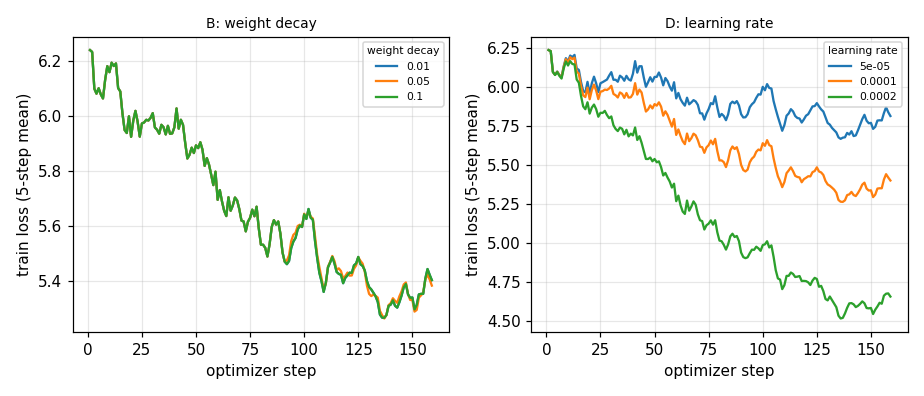
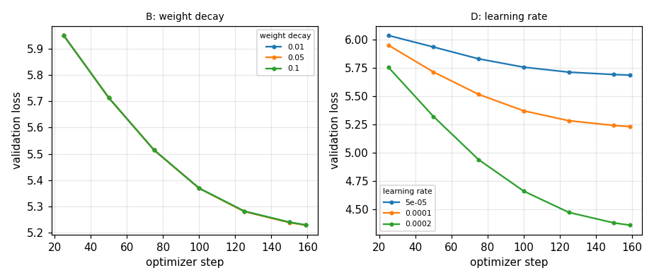
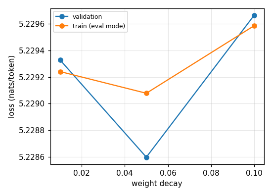
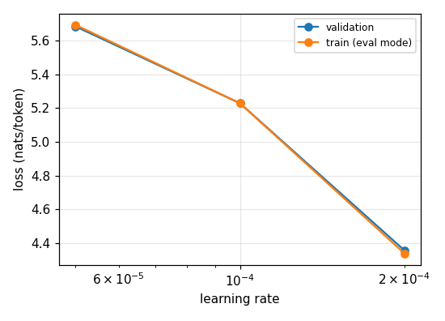
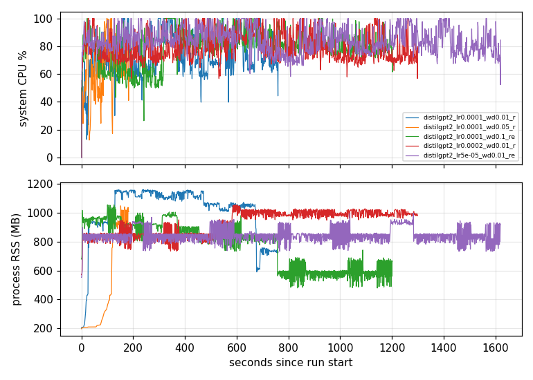

# CPU-only LoRA scaling experiment: report

> Small-scale, CPU-only measurements. They do **not** validate or extrapolate to quadrillion-parameter scaling laws; they only show how these knobs behave for sub-100M models under tight resources.

Completed runs: **5**

## 1. Hardware configuration

| item | value |
|---|---|
| cpu_model | Intel(R) Core(TM) i5-6300U CPU @ 2.40GHz |
| gpu_name | None |
| physical_cores | 2 |
| logical_cores | 4 |
| ram_total_gb | 7.65 |
| ram_available_gb | 0.97 |
| disk_free_gb | 23.51 |
| os | Windows-10-10.0.19045-SP0 |

Design target: Lenovo ThinkPad T470s, i5-6300U (2C/4T), 8 GB RAM, CPU-only. Notes: none

## 2. Software dependencies

- torch: 2.11.0+cpu
- transformers: 5.18.0
- peft: 0.21.2
- wandb: not installed
- datasets: 5.1.0
- psutil: 7.1.0
- pandas: 2.3.3
- matplotlib: 3.10.7
- python: 3.13.7

## 3. Model specifications

| model | total params | frozen base | trainable (LoRA) | trainable % of base |
|---|---|---|---|---|
| distilgpt2 | 82060032 | 81912576 | 147456 | 0.18 |

## 4. Fine-tuning methodology

Frozen pretrained causal LM + LoRA adapters on the attention input projection, FP32 on CPU, AdamW with cosine schedule, gradient clipping 1.0, record-level train/validation split (seeded) performed before repetition and packing, so repeated data never leaks into validation. Corpus: synthetic Indonesian medical-record notes unless `data.source` points to local files. Validation loss is token-weighted cross-entropy; bits/char (bpc) normalises across tokenizers.

## 5. Training configuration

```
seed: 42
hardware:
  device: cpu
  num_threads: 2
  max_train_ram_gb: 4.0
  min_available_ram_gb: 0.6
  min_free_disk_gb: 3.0
  sample_interval_s: 1.0
model:
  name: distilgpt2
  max_params_millions: 100
  local_files_only: false
data:
  source: synthetic
  n_records: 600
  val_fraction: 0.15
  max_seq_len: 128
  repeat: 1
  scrub_pii: true
lora:
  r: 8
  alpha: 16
  dropout: 0.05
train:
  batch_size: 1
  grad_accum: 4
  epochs: 1
  learning_rate: 0.0001
  weight_decay: 0.01
  max_grad_norm: 1.0
  warmup_ratio: 0.05
  min_lr_ratio: 0.1
  max_steps: null
  eval_every_steps: 25
  checkpoint_every_steps: 25
  eval_batch_size: 4
  max_eval_blocks: 64
  eval_train_blocks: 32

```

## 6. Training and validation loss curves





## 7. Weight decay comparison (B)



| model | lr | wd | rep | r | seed | train loss (eval) | val loss | val bpc | time (s) | peak RSS (MB) |
|---|---|---|---|---|---|---|---|---|---|---|
| distilgpt2 | 0.0001 | 0.01 | 1 | 8 | 42 | 5.229 | 5.229 | 3.53 | 729.7 | 1164 |
| distilgpt2 | 0.0001 | 0.05 | 1 | 8 | 42 | 5.229 | 5.229 | 3.529 | 765.3 | 1111 |
| distilgpt2 | 0.0001 | 0.1 | 1 | 8 | 42 | 5.23 | 5.23 | 3.53 | 1197 | 1179 |

## 8. Repeated data comparison (C)

_Repetition vs loss: no data_

_no completed runs_

## 9. Learning-rate comparison (D)



| model | lr | wd | rep | r | seed | train loss (eval) | val loss | val bpc | time (s) | peak RSS (MB) |
|---|---|---|---|---|---|---|---|---|---|---|
| distilgpt2 | 0.0001 | 0.01 | 1 | 8 | 42 | 5.229 | 5.229 | 3.53 | 729.7 | 1164 |
| distilgpt2 | 0.0002 | 0.01 | 1 | 8 | 42 | 4.338 | 4.357 | 2.941 | 1294 | 1179 |
| distilgpt2 | 5e-05 | 0.01 | 1 | 8 | 42 | 5.695 | 5.685 | 3.837 | 1614 | 1179 |

## Model capacity (A) and PEFT (E)

_Capacity vs validation bpc: no data_

_no completed runs_

_no completed runs_

## 10. CPU and RAM utilisation



| run | mean CPU % | max CPU % | peak RSS (MB) | min free RAM (GB) |
|---|---|---|---|---|
| distilgpt2_lr0.0001_wd0.01_rep1_r8_s42 | 73.3 | 100 | 1164 | 0.379 |
| distilgpt2_lr0.0001_wd0.05_rep1_r8_s42 | 61.7 | 100 | 1111 | 0.353 |
| distilgpt2_lr0.0001_wd0.1_rep1_r8_s42 | 78.8 | 100 | 1179 | 1.178 |
| distilgpt2_lr0.0002_wd0.01_rep1_r8_s42 | 79.5 | 100 | 1179 | 1.246 |
| distilgpt2_lr5e-05_wd0.01_rep1_r8_s42 | 84.2 | 100 | 1179 | 0.821 |

## 11. Training time

| run | total (s) | s/optimizer step | steps | tokens processed |
|---|---|---|---|---|
| distilgpt2_lr0.0001_wd0.01_rep1_r8_s42 | 729.7 | 4.589 | 159 | 81408 |
| distilgpt2_lr0.0001_wd0.05_rep1_r8_s42 | 765.3 | 85.04 | 159 | 81408 |
| distilgpt2_lr0.0001_wd0.1_rep1_r8_s42 | 1197 | 7.528 | 159 | 81408 |
| distilgpt2_lr0.0002_wd0.01_rep1_r8_s42 | 1294 | 8.139 | 159 | 81408 |
| distilgpt2_lr5e-05_wd0.01_rep1_r8_s42 | 1614 | 10.15 | 159 | 81408 |

## Observations (auto-generated from the numbers above)

- B: weight decay: lowest mean validation loss at weight decay = 0.05 (5.2286); spread across settings 0.0011 nats/token. Single seed: differences of this size cannot be separated from run-to-run noise.
- D: learning rate: lowest mean validation loss at learning rate = 0.0002 (4.3566); spread across settings 1.3285 nats/token. Single seed: differences of this size cannot be separated from run-to-run noise.

## 12. Limitations and reproducibility

- Single seed unless `--seeds` was given; treat small differences as noise.
- Validation split is drawn from the same synthetic generator, so it is easy and templated; real records will behave differently and need a clinically meaningful held-out split.
- Experiment C repeats data within a fixed 1 epoch, so more repetitions also means more optimizer steps.
- Experiment A compares different pre-trained models (architecture, tokenizer, pre-training data), not a controlled parameter-count sweep; bpc corrects only for tokenization.
- Weight decay on LoRA matrices over very short schedules has weak effects; absence of a trend is a valid result.
- Wall-clock figures depend on background load; see the hardware notes above.
- Reproduce: same config, seed 42, same package versions (metadata.json), CPU thread count fixed. Bitwise-identical results across machines are not guaranteed.
